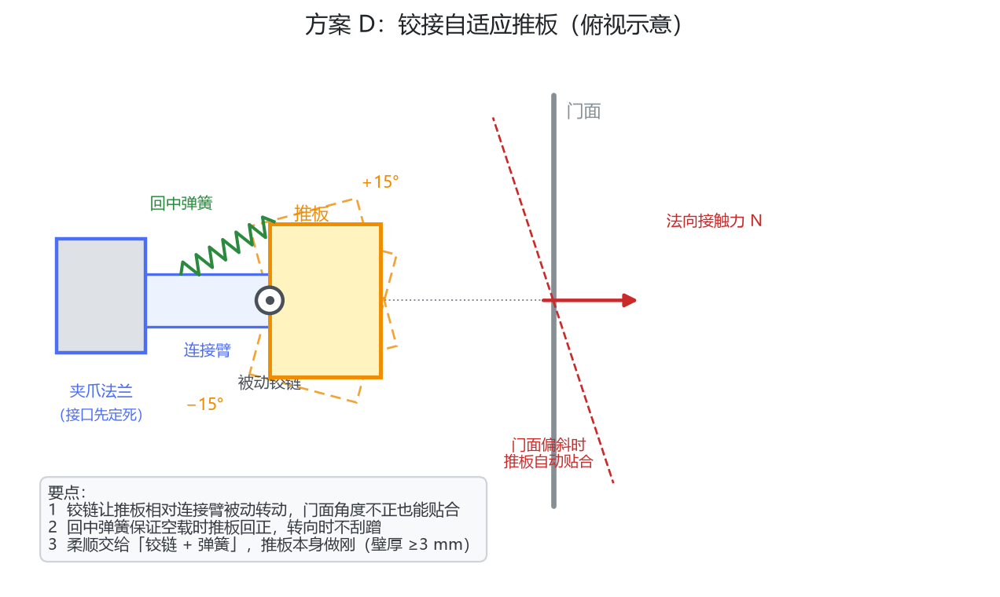

# 推门工具设计：一个可执行的框架

> 给机器人做一个"推门"末端工具。核心不是画得好看，而是**接触时不打滑、不较劲、力传得进去**。

## 第一步：先量，再画

| 要量的量 | 为什么 |
|---|---|
| 门板厚度 | 决定工具开口 |
| 把手直径 / 截面形状 | 决定接触面形状（圆把手最容易打滑） |
| 门缝宽度 | 决定插入深度 |
| 开门所需力（三档：轻/中/重） | 决定结构强度 |
| 夹爪最大开口与夹持力 | 决定工具能不能装、会不会被夹坏 |

**没量完不要建模。** 大模型直接"画"出来的东西，缺的就是这几个数。

## 第二步：三个工程要素

### 刚度

门是刚性的，工具不能和门"硬碰硬"。做法不是上串联弹性执行器（SEA 是关节方案，不是末端工具方案），而是：

- 接触面用柔性材料（橡胶、TPU、硅胶）吸收冲击；
- 结构上留一点被动自由度（弹簧片、铰链），让工具能贴合门面角度。

### 摩擦

推门打滑，多半是接触面积小或材料太硬。

- 橡胶/硅胶垫增大摩擦，且能适应把手曲面；
- 圆把手用"V 形槽"或"包覆式"接触，比平面直推稳。

### 接触力

推门是**持续接触**，不是撞击。

- 工具要能承受并传递稳定推力，结构不能一推就变形；
- 若机器人有力控，工具设计要让力"传得进去"（刚性足够），柔顺交给控制，而不是全靠材料软。

## 第三步：三种结构，选一个先做

| 方案 | 结构 | 优点 | 缺点 | 适用 |
|---|---|---|---|---|
| 单点推杆式 | 一根带橡胶头的杆 | 最简单、最轻 | 圆把手易滑，力集中 | 平门、轻门 |
| 滚轮式 | 前端装一个可转动的滚轮 | 顺门面滑动，适合连续推 | 结构稍复杂 | 大面积门板 |
| 包覆/吸附式 | 仿形夹口或吸盘 | 抓得牢 | 对尺寸敏感、换门就废 | 固定场景 |

**先用纸板/泡沫做 1:1 原型**，套在夹爪上推三次，比在软件里渲十版有用。

## 第四步：怎么验证

1. 同一扇门，推 10 次，记成功次数、耗时、打滑次数；
2. 换一扇不同厚度的门，再推 10 次；
3. 把"打滑"和"推不开"分开记——这是两种完全不同的问题。

## 五种可建模的方案

> 选一个先做，不要五个都建。括号里是"决定成败的那个尺寸"。

### 方案 A：U 形推杆 + 橡胶头（最简单）

- 结构：一根 L/U 形杆，前端半球形橡胶头，直接顶门板或把手侧面。
- 关键参数：**门厚 t**（决定 U 形开口）、杆长（决定力臂）、橡胶邵氏硬度 50—60A。
- 材料：PETG 打印 + 硅胶套。
- 适用：平门、轻门；**不适用**圆把手（必滑）。

### 方案 B：V 形槽包覆块（推把手）

- 结构：前端开一个 V 形槽，卡住把手再推。
- 关键参数：**槽宽 = 把手直径 + 1—2 mm 压缩量**、槽角 90—120°。
- 材料：TPU 95A（软，能变形贴合）。
- 适用：圆把手、方把手；换门要重做（对尺寸敏感）。

### 方案 C：滚轮推板（大面积门板）

- 结构：一块背板 + 两个可转动的尼龙轮/轴承轮，贴门面滚动。
- 关键参数：**轮径 30—40 mm**、轮距、背板与门面的预压量。
- 优点：顺着门面滑，适合连续推、门面不平也能过。
- 风险：轮子卡门缝、转向时侧滑。

### 方案 D：铰接自适应推板（解决"门面和机器人不平行"）

- 结构：推板 + 一个被动铰链（±15°），板自己贴合门面角度。
- 关键参数：**铰链回中弹簧刚度**、板面尺寸。
- 优点：容错高，机器人不用对得特别正。
- 这是最接近"工程上能用"的方案，建模也最简单：板 + 铰链 + 弹簧销。

### 方案 E：仿形指套（直接夹把手）

- 结构：套在夹爪指尖上的仿形块，夹住把手再推/拉。
- 关键参数：**夹爪最大开口**、指套厚度（不能超过夹爪闭合余量）。
- 优点：最稳，能拉能推。
- 风险：依赖夹爪行程和夹持力，换夹爪就废。

## 用这些方案驱动建模（SolidWorks）

1. **先建接口**：法兰/燕尾槽，和夹爪的连接尺寸先定死。接口错了，功能头再漂亮也装不上。
2. **参数化**：把门厚、把手直径、夹爪开口设成全局变量，改一个数全模型跟着变。
3. **先做 3 个版本，不做 1 个精品**：A/B/D 各建一个粗糙版，打印出来试，比精修一版强。
4. **打印方向**：受力方向要和层纹垂直，否则一推就断。
5. **导出 STL 前检查**：壁厚 ≥ 2 mm、圆角 ≥ 1 mm、不要有悬空面。

## 方案 D 详图（推荐先做这个）

### 建模参数（先填这张表，再开 SolidWorks）

| 参数 | 建议值 | 说明 |
|---|---|---|
| 推板尺寸 | 100 × 150 mm | 覆盖门板中段，别做太小 |
| 推板壁厚 | 3—4 mm，加两条筋 | 太薄一推就弯，力传不进去 |
| 前表面 | 贴 2 mm 硅胶垫 | 增大摩擦，保护门漆 |
| 铰链轴径 | φ5，尼龙衬套 | 间隙 0.1—0.2 mm |
| 铰链位置 | 距法兰 40—60 mm | 给板留转动空间 |
| 转动范围 | **±15°，必须加机械挡块** | 没有挡块，弹簧会被拉坏 |
| 回中弹簧 | 拉簧 0.5—1 N/mm 或扭簧 0.05—0.1 N·m/° | 能回正即可，不需要很大 |

### 三个关键设计点

1. **挡块比弹簧重要**：±15° 用两个 M3 螺钉做机械限位，弹簧只负责回中。
2. **铰链要"松"**：转动阻力越小，贴合越好；别用紧配合。
3. **板要"刚"**：柔顺交给铰链，推板本身必须硬，否则推力被板自己吃掉。

### 和门的关系

门面偏斜 15° 以内，推板自动贴合；超过 15°，先靠机器人姿态调整，再靠推板。
**别指望一个工具解决所有门**——先覆盖现场 80% 的门，再谈通用。

## 开源模型与可借鉴的设计

> 结论先说：**没有现成的"机器人推门末端工具"开源 STL 能直接装上用**。能借的是"人用开门器"的几何形状，接口必须自己建。

| 来源 | 是什么 | 怎么用 |
|---|---|---|
| [Hands-free door opener（圆/椭圆/弧形把手）](https://creazilla.com/ja/media/3d-model/7855310/hands-free-door-opener-for-round-ellipsoid-and-arcuate-door-handles) | 人用的免接触开门钩，几何针对圆把手 | 借它的**钩形与包覆角**，改成夹爪接口 |
| [Hooky 大开门器 + 按钮推杆](https://cults3d.com/zh/3d-m%C3%B3x%C3%ADng/g%C5%8Dngj%C3%B9/big-door-opener-and-button-pusher-hooky) | 钩 + 推两种功能合一 | 借"钩+推"双功能的思路 |
| [开门器 STL 合集（Creality Cloud）](https://www.crealitycloud.com/zh/model-detail/3d-printed-door-opener) | 多种家用开门器 | 看不同把手形状怎么处理 |
| [STL Finder：door handle opener 合集](https://www.stlfinder.com/3dmodels/door-handle-opener/) | 聚合搜索 | 按把手直径筛 |
| [Basic Robot Gripper（Printables）](https://www.printables.com/model/1614140-basic-robot-gripper) | 开源夹爪模型 | 借**指套/夹口接口**的建模方式 |
| [Underactuated gripper for opening doors（UMass 论文）](https://robotics.cs.uml.edu/fileadmin/content/publications/thesis/rapacki-MS-thesis-2009.pdf) | 专门为开门设计的欠驱动夹爪 | 读"为什么门把手难抓"这一章 |
| [Learning to Design 3D Printable Adaptations（ObjectAdapt）](https://zhaomingxie.github.io/projects/ObjectAdapt/ObjectAdapt.pdf) | 用 3D 打印件改造物体以适配机器人 | 方法论：先扫描/测量，再生成适配件 |

### 改造现成模型的四个动作

1. **缩放前先量**：所有模型都是给人手设计的，把手直径和你现场的门不一定一样。
2. **切掉手柄，接上法兰**：人用的件靠手握，机器人靠夹爪——把尾部改成与夹爪匹配的燕尾/圆孔接口。
3. **补壁厚**：家用件壁厚 1.2—1.6 mm 够，机器人推门受力大，加厚到 3—4 mm 或加筋。
4. **换材料**：PLA 太脆，用 PETG 或 TPU；接触面贴硅胶垫。

### 一个提醒

先搜再做，但**别以"找到现成模型"为目标**。这类工具的门槛不在外形，在"接口 + 尺寸 + 材料"，这三样只能自己定。

### 国外站点打不开怎么办

creazilla、cults3d、printables、stlfinder 都是境外站，国内访问经常超时。三个替代：

1. **国内模型站**（关键词用中文，命中率更高）：
   - [创想云 Creality Cloud](https://www.crealitycloud.cn/)——搜「开门器」「免接触」「门把手」
   - [MakerWorld（拓竹）](https://makerworld.com.cn/zh)——搜「door opener」「handle」
   - 打印啦、3D 虎、魔猴网 也有合集
2. **只看图不下载**：这些模型的价值是"形状长什么样"，看到截图就够，不必真的下载。
3. **买实物参考**：淘宝搜「免接触开门器」，十几块钱一个，拿到手里比看 STL 直观。

## 用 SolidWorks 自己建（推荐，30 分钟）

你机器上装了 SolidWorks 2026，**自己建比找模型快**，而且能参数化——改一个数，门厚、把手直径全跟着变。

### 尺寸表（先填，再画）

| 参数 | 现场量 | 用途 |
|---|---|---|
| 门厚 `door_t` | ___ mm | 决定 U 形开口 |
| 把手直径 `handle_d` | ___ mm | 决定 V 槽宽度 |
| 门缝 `gap` | ___ mm | 决定插入深度 |
| 夹爪开口 `jaw` | ___ mm | 决定法兰尺寸 |
| 开门力 | ___ N（轻/中/重） | 决定壁厚 |

### 特征顺序

1. **全局变量**：`door_t`、`handle_d`、`jaw` 建在「方程式」里，后面尺寸全部引用它们。
2. **推板主体**：拉伸 120 × 80 × 8 mm，四角 R5。
3. **V 槽**：草图梯形，槽宽 = `handle_d + 3`（1.5 mm 压缩量 ×2），槽深 12 mm，槽角 90°。
4. **法兰**：按夹爪接口画（燕尾或圆孔），**接口先定，功能头后画**。
5. **铰链耳**：两侧各一个耳片，销孔 φ4，允许 ±15° 摆动。
6. **倒角/圆角**：受力边 R2，避免应力集中。
7. **干涉检查**：在 SW 里建一个简化的「门 + 把手」实体，装配后跑一次干涉检测。
8. **导出 STL**：0.2 mm 层高、4 层壁、40% 填充、PETG。

### 打印方向

**让推力的方向垂直于层纹。** 平放打印的板，层与层之间最弱，推门时容易从层间裂开；把板立起来打，或加筋。

## 常见错误

- 用 SEA 做末端工具（过度设计，SEA 是关节柔顺方案）；
- 只看 3D 图不看实物尺寸；
- 把"推不动"和"打滑"混为一谈，导致改错方向。
